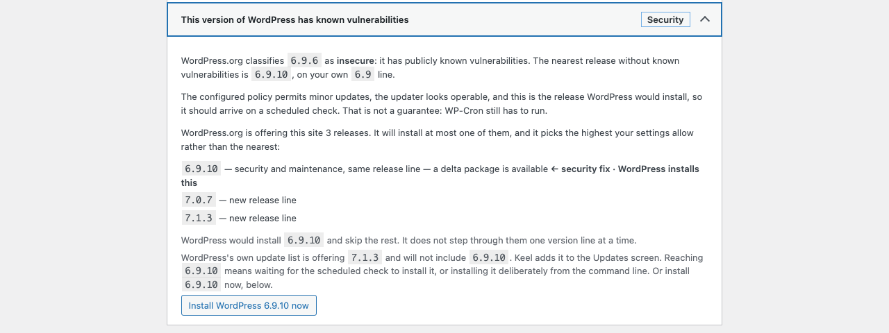
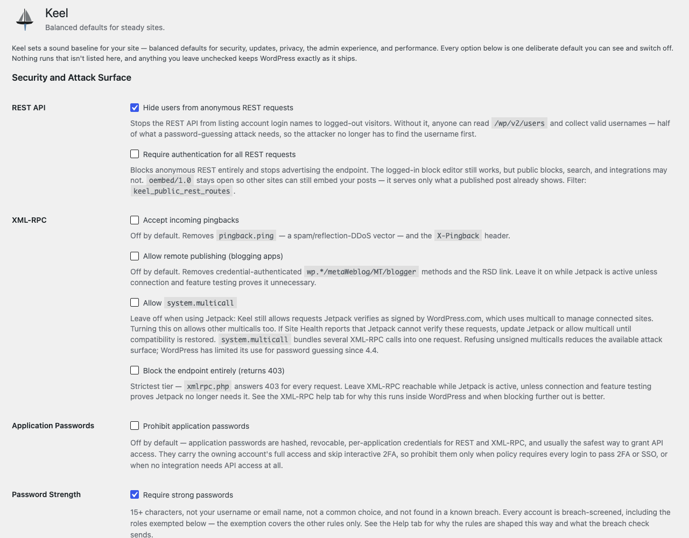
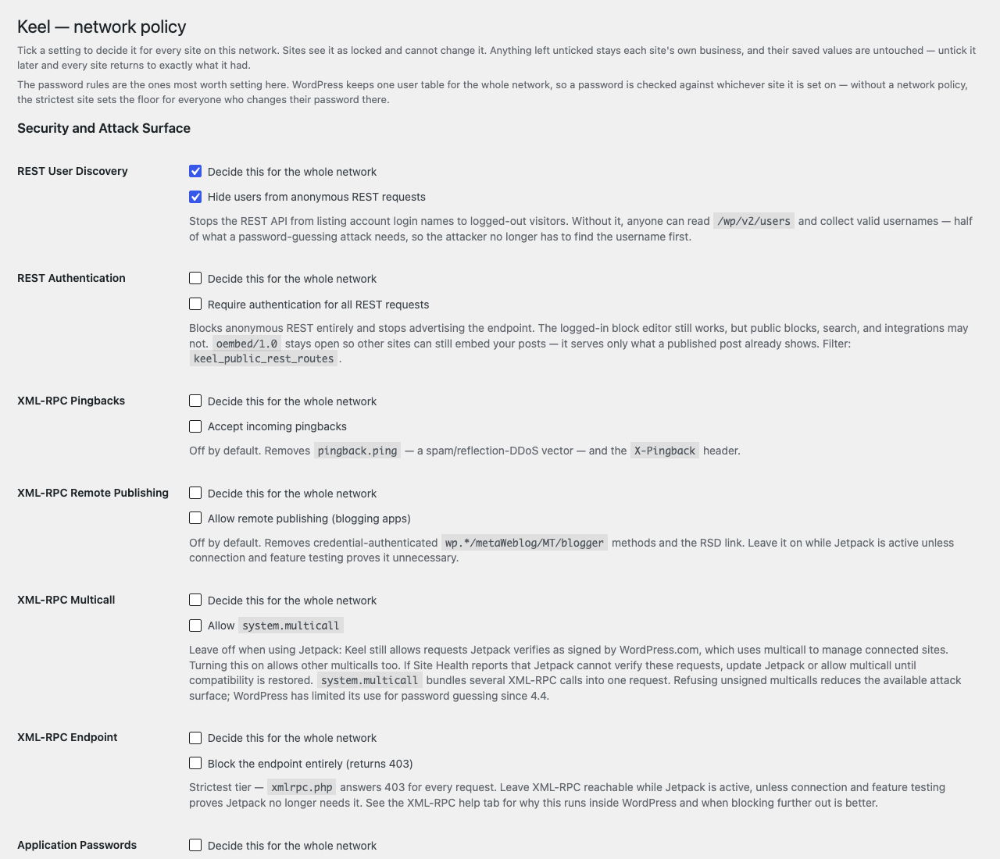
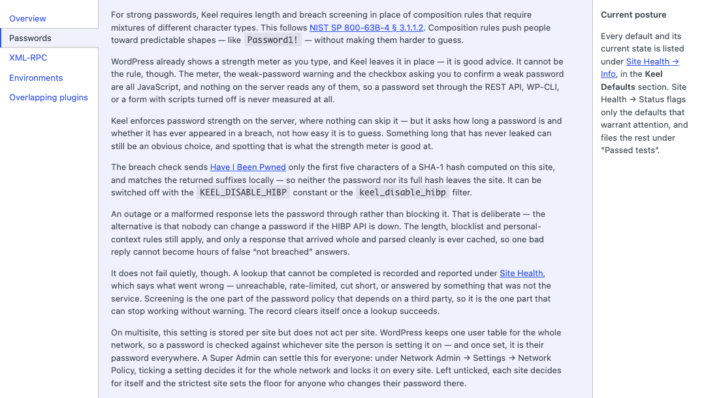
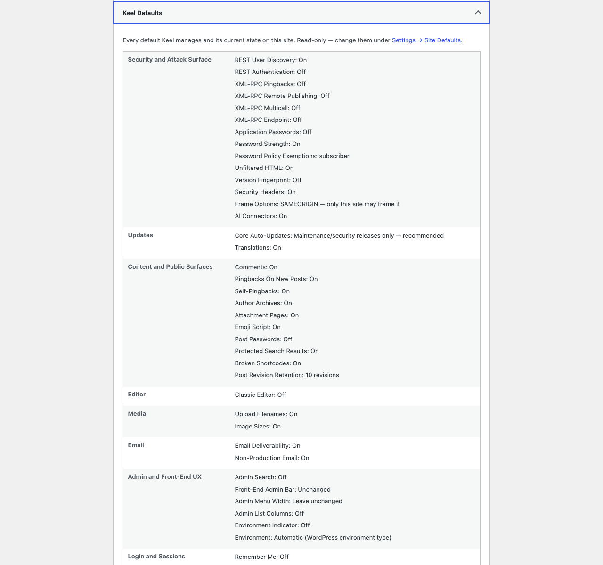

# Keel

         

**A clear, maintainable baseline for secure WordPress sites.** Keel provides 44 individually configurable settings for security, updates, privacy, content, email, media, and wp-admin. Some depend on other settings, and configuration or network policy can manage them centrally. It is designed for people responsible for many sites, or for sites where predictable operations matter. Keel is Multisite compatible.

**Current version: `0.9.0` (release candidate; not yet published).** The [readme.txt changelog](readme.txt) lists what it adds to the last published release.

An administrator can download a sanitized JSON posture report from Site Defaults for support. It contains validated policy choices and cached summaries, with unknown evidence marked explicitly. It omits site/user identifiers, raw option records, callback paths and full plugin/theme inventories. On multisite, export requires network-management authority.

## Try it first

No install or hosting required: WordPress Playground opens a disposable WordPress site with Keel enabled and a sample post ready to inspect.

- **[Try the current stable release](https://playground.wordpress.net/?blueprint-url=https://raw.githubusercontent.com/dknauss/Keel/main/playground/blueprint-stable.json)** — the published plugin package.
- **[Try the current `main` build](https://playground.wordpress.net/?blueprint-url=https://raw.githubusercontent.com/dknauss/Keel/main/playground/blueprint-hosted.json)** — the rolling build for testing changes before a release.
- **[See the conflict diagnostics](https://playground.wordpress.net/?blueprint-url=https://raw.githubusercontent.com/dknauss/Keel/main/playground/blueprint-conflict-diagnostics.json)** — the `main` build beside Disable Comments, Classic Editor and Disable XML-RPC, so the Dashboard notice and **Tools → Site Health** show which plugins share Keel's hooks and which setting another plugin is overriding.

The stable demo follows each release; the rolling demo is rebuilt after successful pushes to `main`. See [the Playground blueprint notes](playground/README.md) for their contracts and a quick availability check.

## What it does

Keel explains each setting under **Settings → Site Defaults**, with a separate Network Admin policy screen for multisite. Keel reports its current effective posture in **Tools → Site Health**. It does not edit or delete existing content (new uploads do get lowercase filenames), and settings can be adjusted unless configuration or network policy manages them. Some controls appear only when their related feature is enabled.

Keel's settings are intended to:

- **Reduce accidental exposure:** anonymous user discovery, author archives, comments, pingbacks, attachment pages, raw HTML, security headers, AI connectors, and more.
- **Make routine maintenance safer:** conservative core update settings, visible update blockers, email-delivery checks, revision retention, and upload filename normalization.
- **Protect non-production sites:** outgoing mail is suppressed outside production by default, preventing a staging or local copy from sending to real recipients.
- **Make operations legible:** Site Health lists the active state of every default, flags attributable policy overlaps with other plugins, checks that Keel's own protections are still registered, and lists plugins that override Abilities API permissions.
- **Run a network without flattening every site**: a Super Admin can decide selected defaults for the whole network, while each site keeps its own choices underneath. Enforced settings are visibly locked, and lifting the policy restores every saved local choice.

### See all available WordPress core updates

Keel independently checks WordPress.org's `stable-check` status for the installed core version. If a release line has a known vulnerability and a same-line fix exists, Keel names that exact patch, explains what WordPress's Updates screen is offering, and lets an authorized administrator deliberately install only that same-line patch through WordPress's upgrader with rollback enabled.

This is intentionally distinct from asking whether a newer major release exists. A secure same-line patch may be hidden as an automatic-update offer, absent from the Updates screen, or unavailable because WordPress.org has not published one. Keel reports the uncertainty or blocker rather than implying that an update is available when it is not. Details: [core update and stable-check behavior](docs/wordpress-default-settings.md#5-update-policy).

### Make update policy visible

The Updates screen keeps WordPress's own policy text and adds a **Keel update policy** notice above **Current version**. It names the release branch, explains the configured core policy and where it comes from (a constant, network policy or the site setting), and links to the control. It says plainly that a policy is not a delivery guarantee: cron, hosting and other plugins can still decide what installs and when.

Plugin and theme auto-updates have separate Enabled, Disabled and Leave unchanged controls. Both default to Leave unchanged, so WordPress's per-item choices stand until you choose otherwise, and an explicit choice never rewrites them. There is no minor-only channel for plugins or themes, because their version numbers carry no enforced meaning.

For troubleshooting, **Site Health → Status → Update diagnostics** shows the core-update delivery evidence (selected release, branch-tip status, check-attempt age, scheduled checks and retained failure codes) and each type's auto-update decisions in plain tables. **Site Health → Info** lists the data categories WordPress's normal update checks send to WordPress.org, without showing this site's values. Details: [update policy reference](docs/wordpress-default-settings.md#5-update-policy) and the [notice verification record](docs/review/update-policy-notice-2026-10-22.md).

### Find autoload and cron pressure

Site Health reports the ten largest observed autoloaded options, their byte sizes,
and probable owners with confidence and evidence. It collects names and sizes in
cached background batches, never values. Partial scans are labelled explicitly;
size alone does not prove waste. The report never deletes options or changes their
autoload flags. See the [limits and verification](docs/review/autoload-attribution-2026-10-21.md).

It also adds cached observations of overdue and frequent stored cron events,
probable owners with explicit confidence, core offer-cache age and retained
core-update failure codes. Event arguments and error data never enter the report.
External scheduling, missing timestamps and incomplete coverage remain explicit;
no jobs, schedules or update policy are changed and no installation time is promised.
See the [limits and verification](docs/review/cron-attribution-2026-10-21.md).

## Screens

## Technical guide

### Design

`keel_defaults_schema()` is the configuration source of truth. It drives the settings UI, validation, Site Health, and the bootstrap hooks that apply enabled defaults. Settings are per-site; network policy and selected `wp-config.php` constants are evaluated as higher-priority effective values, without overwriting the stored site configuration.

Keel avoids cosmetic-only controls. For example, disabling comments also closes query and feed surfaces, while a closed REST API stops advertising itself but retains oEmbed so other sites can still embed posts. The [per-setting reference](docs/wordpress-default-settings.md) documents the behavior, scope, tradeoffs, constants, and filters for every setting.

Broken-shortcode cleanup is conservative and paired with recent Site Health evidence. It preserves enclosed text, editable-post visibility and
literal examples; see [scope and limits](docs/wordpress-default-settings.md#broken-shortcodes).

### Integration and operations

- **Requirements:** WordPress 6.4+, PHP 7.4+.
- **External services:** optional password breach screening uses HIBP's k-anonymous range API; the core security-status check uses WordPress.org's stable-check API. See the [WordPress.org listing](https://wordpress.org/plugins/keel-defaults/) for full disclosures.
- **Configuration:** prefer the settings screen. Deployment-level constants and documented filters are available when code ownership is appropriate; see [the reference](docs/wordpress-default-settings.md).
- **Multisite:** a Super Admin uses **Network Admin → Settings → Network Policy** to decide individual settings for every site. Policy is read-time and visibly locked on sites; it never rewrites stored site settings, so removing it restores each site's previous choice.
- **Compatibility:** Keel identifies attributable shared policy hooks without executing third-party callbacks. Treat a reported overlap as a prompt to compare configuration, not as proof that another plugin must be removed. The [conflict diagnostics demo](https://playground.wordpress.net/?blueprint-url=https://raw.githubusercontent.com/dknauss/Keel/main/playground/blueprint-conflict-diagnostics.json) runs Keel beside Disable Comments, Classic Editor and Disable XML-RPC so you can see the Dashboard notice and the Site Health report; how overlaps are classified is in [the reference](docs/wordpress-default-settings.md#when-another-plugin-touches-the-same-policy).
- **Registration audit:** Site Health checks that Keel's comment-feed, author-feed, author-archive, attachment-page and session-length protections are still registered at a priority where they work. It reports missing or outranked registrations without running other code or repairing anything; see [the audit record](docs/review/runtime-registration-audit-2026-10-22.md).

### Development and verification

The test suite is standalone PHP scripts in [`tests/`](tests/), run with `php tests/<name>.php`. On every push and pull request, CI runs syntax, coding-standards, and PHP-compatibility checks, WordPress ESLint and Stylelint rules for browser assets, the scoped PHPStan pilot and its contract examples, plus the unit tests on each PHP version from 7.4 through 8.5; pushes to `main` also build the plugin zip for the rolling Playground demo. Dependency-advisory checks and CodeQL analysis of browser JavaScript run on pull requests, `main` and a weekly schedule. The HTTP authorization lab builds disposable single-site and multisite installs on every pull request and checks admin-post, admin-ajax and settings requests by role through real WordPress cookies and nonces ([evidence](docs/review/http-authorization-2026-10-24.md)). A separate scheduled matrix exercises live WordPress installer and backport paths. The release package is built with `bash bin/build-zip.sh build`.

Useful references:

- [Contributing](CONTRIBUTING.md)
- [Default behavior and technical reference](docs/wordpress-default-settings.md)
- [Hooks reference](docs/hooks.md)
- [Constants and locked settings](docs/constants-and-locks.md)
- [Data inventory](docs/data-inventory.md)
- [Environment detection](docs/environment-detection.md)
- [AI integrations](docs/ai-integrations.md)
- [Competitive behavioral probes](docs/competitive-teardown-matrix.md)
- [Review and verification records](docs/review/)
- [Security policy](SECURITY.md)
- [Release roadmap](ROADMAP.md)

## Install

Install from the [WordPress.org directory](https://wordpress.org/plugins/keel-defaults/), or place the plugin folder in `wp-content/plugins/` and activate it. Then visit **Settings → Site Defaults**.

## License and credits

[GPL-2.0-or-later](LICENSE). Keel is a de-branded evolution of [Better by Default](https://github.com/WPYEG/Better-by-Default), with additional defaults adapted from the Agency Experience plugin, itself a fork of [10up Experience](https://github.com/10up/10up-experience). See the WordPress.org readme for complete attribution.
